<div align="center">



<br />


<br />

[](https://github.com/samdavistwo-png)

</div>

<p align="center">
  
  
  
</p>

---

## `01 // WHOAMI`

```text
┌──────────────────────────────────────────────────────────────┐
│ IDENTITY                                                     │
├──────────────────────────────────────────────────────────────┤
│ NAME   : Sam Davis Henry R                                  │
│ ROLE   : Information Technology Student                     │
│ FOCUS  : Cybersecurity / AI / Automation                    │
│ MODE   : BUILD / EXPLORE / LEARN                             │
└──────────────────────────────────────────────────────────────┘
```

I'm an IT student exploring cybersecurity, AI-assisted tools, automation, Linux, and mobile-first development. I like learning by building projects, testing ideas in controlled environments, and documenting what I discover.

> **Security principle:** Observe → Understand → Test responsibly → Fix → Document. Only test systems you own or have explicit permission to assess.

## `02 // TECH STACK & TOOLS`

<p align="center">
  
</p>

<details>
  <summary><b>What these technologies are connected to</b></summary>
  <br />

  - **TypeScript, React, Bun:** used by the JACK mobile assistant project.
  - **Python, SQLite, Telegram bot development:** used by RepotechBot.
  - **Linux, Git, GitHub:** part of my ongoing development and security-learning workflow.

  This section describes technologies connected to my current projects and learning, not professional certifications or mastery claims.
</details>

---

## `03 // FEATURED MISSIONS`

<table>
  <tr>
    <td width="50%" valign="top">
      <h3>MISSION 01 // JACK</h3>
      <p><a href="https://github.com/samdavistwo-png/creating-a-jarvis-on-mobile-is-possible"><b>Creating a JARVIS on Mobile</b></a></p>
      <p>A mobile-friendly AI assistant experiment with English/Tamil voice interaction, user-taught commands, app/site automation, and human-approved extensions.</p>
      <p><sub>STACK: Bun · React · TypeScript</sub></p>
      <a href="https://github.com/samdavistwo-png/creating-a-jarvis-on-mobile-is-possible">ACCESS REPOSITORY →</a>
    </td>
    <td width="50%" valign="top">
      <h3>MISSION 02 // REPOTECH</h3>
      <p><a href="https://github.com/samdavistwo-png/repotech-telegram-bot"><b>Repotech Telegram Bot</b></a></p>
      <p>A Telegram bot project with coin balances, referrals, daily rewards, transfers, an admin interface, and SQLite-backed data.</p>
      <p><sub>STACK: Python · Telegram API · SQLite</sub></p>
      <a href="https://github.com/samdavistwo-png/repotech-telegram-bot">ACCESS REPOSITORY →</a>
    </td>
  </tr>
  <tr>
    <td colspan="2" valign="top">
      <h3>MISSION 03 // SDH-GPT</h3>
      <p><a href="https://github.com/samdavistwo-png/SDH-GPT"><b>SDH-GPT</b></a></p>
      <p>An early-stage AI-related project. The public repository currently has limited documentation, so more detail will be added as the project develops.</p>
      <a href="https://github.com/samdavistwo-png/SDH-GPT">ACCESS REPOSITORY →</a>
    </td>
  </tr>
</table>

---

## `04 // SECURITY MINDSET`

```text
[ RECON ] → [ UNDERSTAND ] → [ TEST IN SCOPE ] → [ REMEDIATE ] → [ REPORT ]
```

- Cybersecurity fundamentals and responsible security experimentation
- Linux and system security learning
- Understanding application behaviour and common weaknesses
- Clear notes, reproducible findings, and remediation-first thinking

I am still learning; this profile reflects my direction and projects rather than claiming professional penetration-testing experience.

---

## `05 // GITHUB TELEMETRY`

<div align="center">


<br />


</div>

### Contribution snake

<picture>
  <source media="(prefers-color-scheme: dark)" srcset="https://raw.githubusercontent.com/samdavistwo-png/samdavistwo-png/output/github-contribution-grid-snake-dark.svg" />
  <source media="(prefers-color-scheme: light)" srcset="https://raw.githubusercontent.com/samdavistwo-png/samdavistwo-png/output/github-contribution-grid-snake.svg" />
  
</picture>

The snake animation appears after the GitHub Actions workflow runs successfully for the first time.

---

## `06 // CURRENTLY EXPLORING`

```bash
$ cat learning.txt
> cybersecurity fundamentals
> Linux and networking
> AI assistants and automation
> application behaviour and security
> building and documenting practical projects
```

## `07 // TERMINAL`

```text
┌──────────────────────────────────────────────────────────────┐
│ sam@cyber:~$                                                 │
├──────────────────────────────────────────────────────────────┤
│ $ whoami                                                    │
│ samdavistwo-png                                              │
│                                                              │
│ $ echo "Learn. Build. Secure."                              │
│ Learn. Build. Secure.                                        │
└──────────────────────────────────────────────────────────────┘
```

<div align="center">

**Build quietly. Let the repositories make the noise.**

<a href="https://github.com/samdavistwo-png">GitHub Profile</a>

</div>
