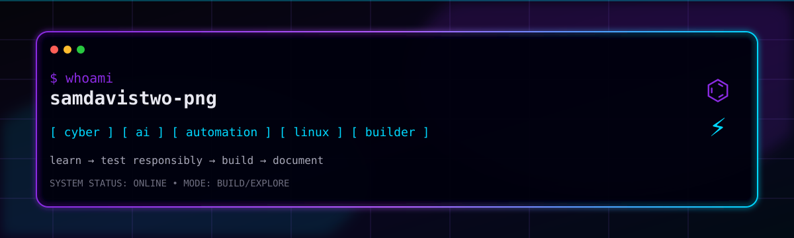

<div align="center">



<br/><br/>

[](https://github.com/samdavistwo-png)

</div>

---

<div align="center">

### `[ SYSTEM ONLINE ]`

`CYBERSECURITY` • `AI` • `AUTOMATION` • `LINUX` • `MOBILE`

</div>

---

## `01 // WHOAMI`

```text
┌─────────────────────────────────────────────────────────────┐
│ IDENTITY                                                    │
├─────────────────────────────────────────────────────────────┤
│ Name      : Sam Davis Henry R                              │
│ Role      : Information Technology Student                 │
│ Focus     : Cybersecurity / AI / Automation                │
│ Environment : Linux / Mobile Development                   │
│ Mode      : BUILD → EXPLORE → LEARN → SECURE               │
└─────────────────────────────────────────────────────────────┘
```

---

## `02 // PHILOSOPHY`

```text
┌─────────────────────────────────────────────────────────────┐
│                                                             │
│  OBSERVE   →   UNDERSTAND   →   TEST   →   FIX   →   DOC  │
│                                                             │
│  Only test systems you own or have explicit permission     │
│  to assess. Security through responsibility.              │
│                                                             │
└─────────────────────────────────────────────────────────────┘
```

---

## `03 // TECH STACK`

<div align="center">


</div>

---

## `04 // SECURITY FOCUS`

```text
╔══════════════════════════════════════════════════════════════╗
║                   SECURITY MINDSET                           ║
╠══════════════════════════════════════════════════════════════╣
║                                                              ║
║  → Cybersecurity learning & experimentation                ║
║  → Linux security tooling & hardening                       ║
║  → Responsible security research                            ║
║  → Understanding system architecture & vulnerabilities     ║
║  → Documentation & knowledge sharing                        ║
║                                                              ║
║  RULE #01: Only test systems you own or have explicit      ║
║            permission to assess.                            ║
║                                                              ║
╚══════════════════════════════════════════════════════════════╝
```

---

## `05 // FEATURED MISSIONS`

### MISSION 01 - JARVIS ON MOBILE

```text
┌──────────────────────────────────────────────────────────────┐
│ JARVIS ON MOBILE: IS IT POSSIBLE?                           │
├──────────────────────────────────────────────────────────────┤
│                                                              │
│ STATUS   : ACTIVE DEVELOPMENT                              │
│ STACK    : TypeScript • Android • Firebase • OpenCV         │
│ PURPOSE  : Exploring AI assistant capabilities on mobile   │
│           devices with real-time processing                │
│                                                              │
│ [ EXPLORE ]                                                 │
│ https://github.com/samdavistwo-png/creating-a-jarvis-on-  │
│ mobile-is-possible                                         │
│                                                              │
└──────────────────────────────────────────────────────────────┘
```

### MISSION 02 - REPOTECH TELEGRAM BOT

```text
┌──────────────────────────────────────────────────────────────┐
│ REPOTECH TELEGRAM BOT                                        │
├──────────────────────────────────────────────────────────────┤
│                                                              │
│ STATUS   : PRODUCTION                                       │
│ STACK    : Python • Telegram API • Database Systems        │
│ PURPOSE  : Full-featured bot with automation, balance       │
│           systems, and integration testing                 │
│                                                              │
│ [ EXPLORE ]                                                 │
│ https://github.com/samdavistwo-png/repotech-telegram-bot   │
│                                                              │
└──────────────────────────────────────────────────────────────┘
```

### MISSION 03 - SDH-GPT

```text
┌──────────────────────────────────────────────────────────────┐
│ SDH-GPT                                                      │
├──────────────────────────────────────────────────────────────┤
│                                                              │
│ STATUS   : EXPERIMENTAL                                     │
│ PURPOSE  : Personal AI assistant & experimentation          │
│           platform for LLM integration                      │
│                                                              │
│ [ EXPLORE ]                                                 │
│ https://github.com/samdavistwo-png/SDH-GPT                  │
│                                                              │
└──────────────────────────────────────────────────────────────┘
```

---

## `06 // CURRENTLY LEARNING`

```bash
$ cat learning.txt

> Advanced Cybersecurity Concepts
> Linux Kernel & System Hardening
> AI / Machine Learning Systems
> Automation & DevOps
> Mobile Security
> Security Experimentation
> Open Source Contribution

$ echo "Focus: Depth over breadth"
Focus: Depth over breadth
```

---

## `07 // GITHUB TELEMETRY`

<div align="center">

[](https://github.com/samdavistwo-png)

[](https://github.com/samdavistwo-png)

</div>

---

## `08 // TERMINAL`

```text
┌──────────────────────────────────────────────────────────────┐
│ sam@cyber:~$                                                 │
├──────────────────────────────────────────────────────────────┤
│                                                              │
│ $ whoami                                                    │
│ samdavistwo-png                                             │
│                                                              │
│ $ echo "Mission: Build secure systems responsibly"         │
│ Mission: Build secure systems responsibly                   │
│                                                              │
│ $ echo "Status: ONLINE"                                    │
│ Status: ONLINE                                              │
│                                                              │
│ $ cat philosophy.txt                                        │
│ Learn → Build → Test Responsibly → Document → Repeat       │
│                                                              │
└──────────────────────────────────────────────────────────────┘
```

---

<div align="center">

**⚡ Build quietly. Let the repositories make the noise. ⚡**

[](https://github.com/samdavistwo-png)

</div>
